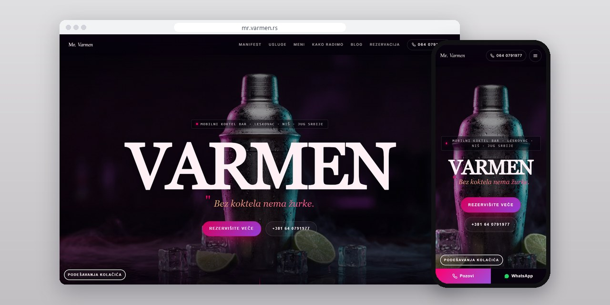
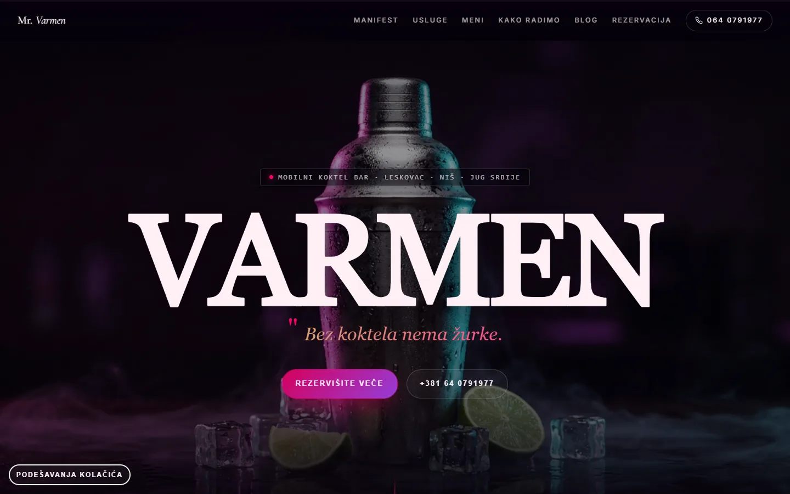
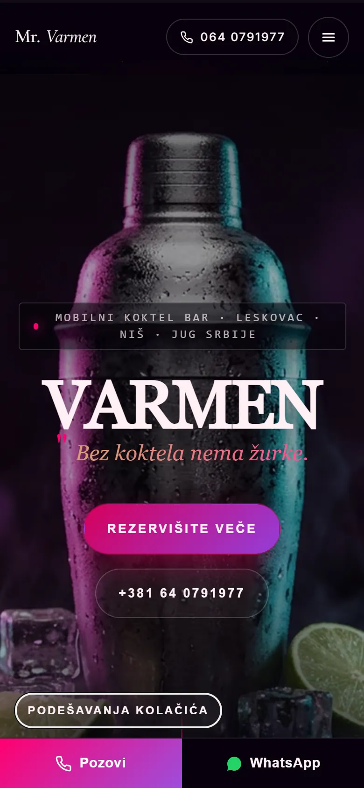
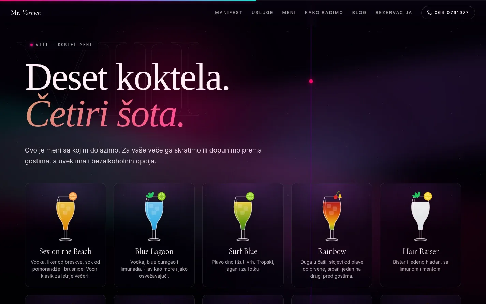
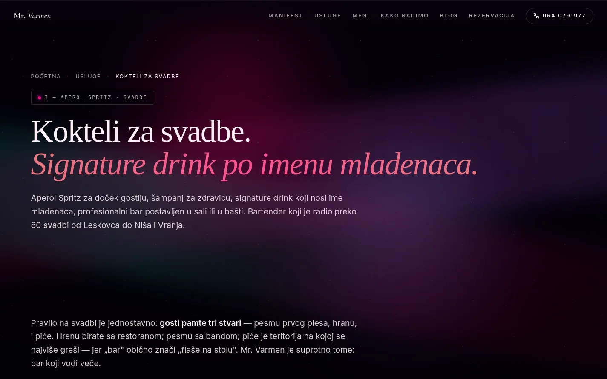

# Mr. Varmen

Site for a mobile cocktail bar from Leskovac that works weddings, birthdays and company events, with its real cocktail menu and a page for each kind of event.

**[mr.varmen.rs](https://mr.varmen.rs/)** · [Case study (in Serbian)](https://svilenkovic.rs/radovi/mr-varmen) · [Srpski](README.sr.md)

> [!NOTE]
> Client project. The source code belongs to the client and stays in a private repository. This page describes what I built and how.

<table>
  <tr><td><b>Client</b></td><td>Mr. Varmen</td></tr>
  <tr><td><b>Industry</b></td><td>Mobile cocktail bar for events</td></tr>
  <tr><td><b>Location</b></td><td>Leskovac, Niš and southern Serbia</td></tr>
  <tr><td><b>Type</b></td><td>Multi-page website</td></tr>
  <tr><td><b>My role</b></td><td>Design, development, SEO, hosting and maintenance</td></tr>
  <tr><td><b>Stack</b></td><td>Astro, JavaScript, PHP, JSON-LD</td></tr>
</table>

## About the project

Mr. Varmen brings a full cocktail bar and a bartender to weddings, birthdays and company events in Leskovac, Niš, Vranje, Pirot, Prokuplje, Vlasotince and Lebane. People do not choose a mobile bar from a list of drinks, so the site first shows the pour and the mood of the evening, then the menu the bar actually brings, and only then asks for the date, the guest count and the place.

The homepage opens with a short full-screen clip of a cocktail being poured. It loops, weighs 1.45 MB (0.57 MB on phones) and starts only after the page has loaded, so it never holds up the first paint. Below it, four stills from the same clip walk through the evening from setting up the bar to serving.

## What I built

- Separate pages for weddings, birthdays, company events and the Niš area, with travel up to 50 km included in the package, plus a blog with five practical posts
- The real cocktail menu, copied from the printed one the bar takes to events: ten cocktails and four shots, each with a drawn glass in the drink's colours, also described as Menu structured data
- A three-step booking flow (conversation, menu proposal, the evening) and a form for date, guest count, event type and location, sent through my central form service with spam protection
- Fonts cut down to the letters the site uses, with č, ć, đ, š and ž in a separate file of a few kilobytes
- Instagram, TikTok and Facebook profiles linked from the footer, the contact page and the structured data
- Static pages from Astro, with the legal pages and cookie settings styled like the rest of the site

## Results

| | Performance | Accessibility | Best practices | SEO |
| :-- | :-: | :-: | :-: | :-: |
| Mobile | 98 | 100 | 100 | 100 |
| Desktop | 95 | 100 | 100 | 100 |

PageSpeed Insights, lab test of the live site, October 2026. Security headers: 6 of 6. axe accessibility check: no violations. Structured data: `FAQPage`, `LocalBusiness`, `Service`.

## Screenshots

<table>
  <tr>
    <td width="68%" valign="top"></td>
    <td width="32%" valign="top"></td>
  </tr>
</table>

The menu the bar brings: ten cocktails and four shots

Each kind of event has its own page, here weddings

---

Built by [D. Svilenković](https://svilenkovic.com).
