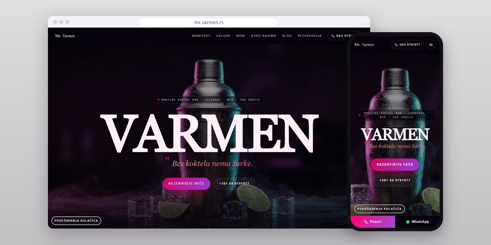
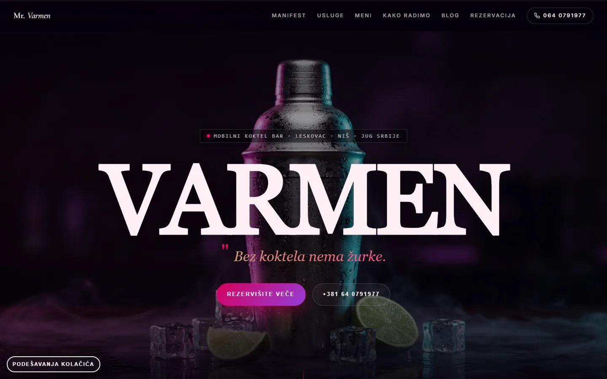
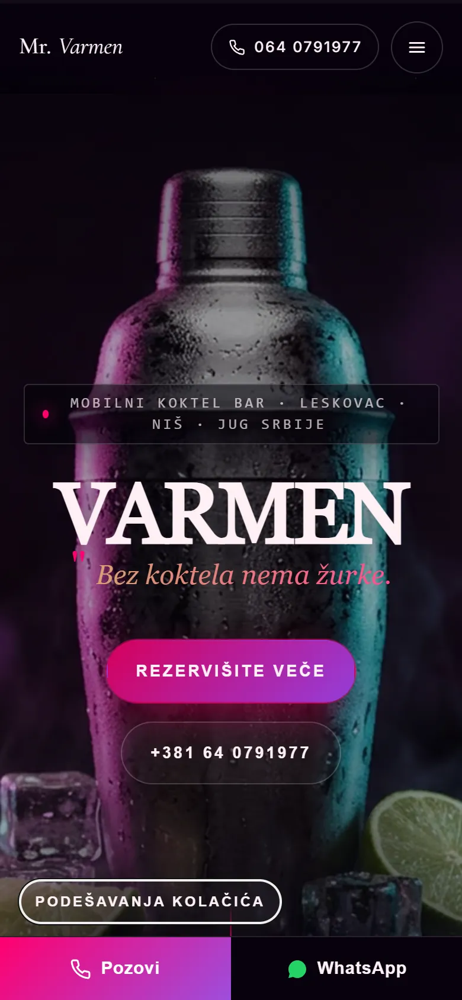
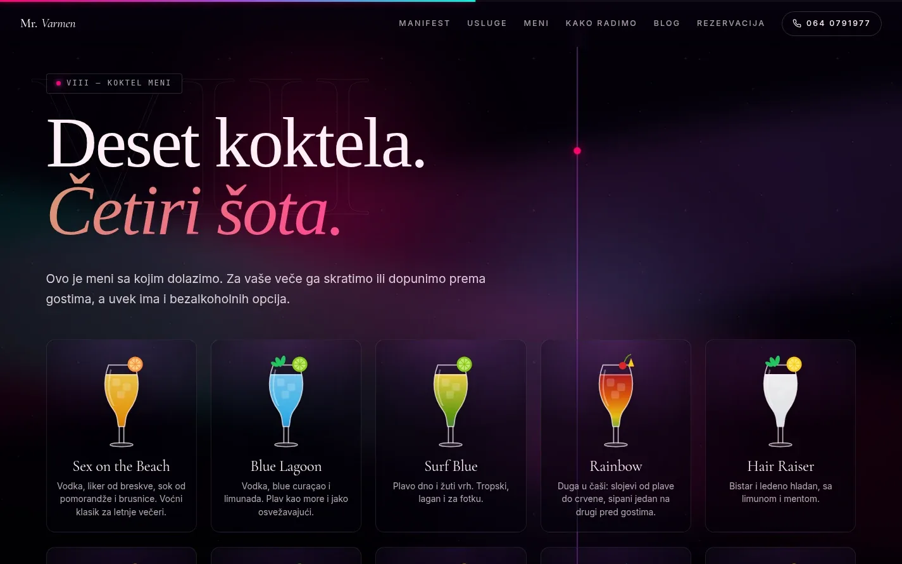
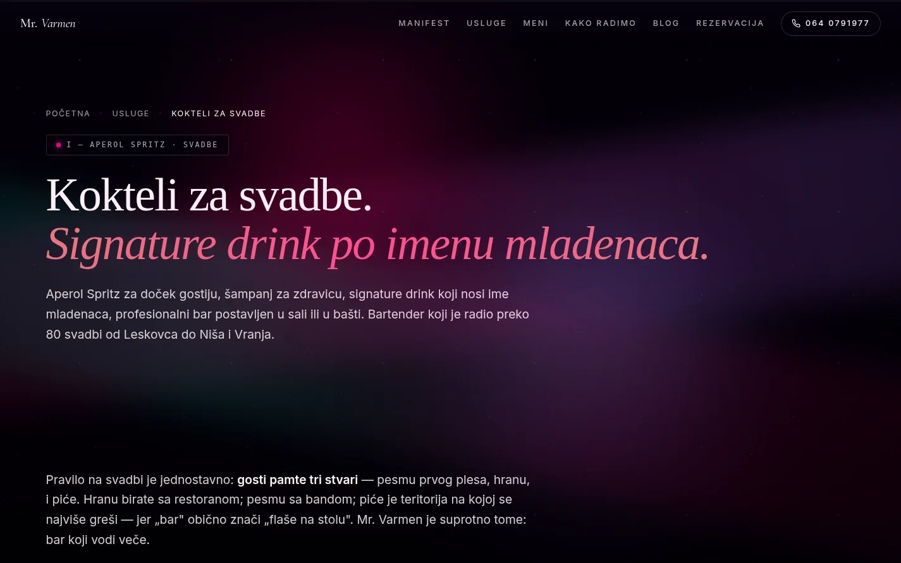

# Mr. Varmen

Sajt mobilnog koktel bara iz Leskovca za svadbe, rođendane i poslovne događaje, sa pravim menijem koktela i stranom za svaku vrstu događaja.

**[mr.varmen.rs](https://mr.varmen.rs/)** · [Studija slučaja](https://svilenkovic.rs/radovi/mr-varmen) · [English](README.md)

> [!NOTE]
> Klijentski projekat. Izvorni kod pripada klijentu i čuva se u privatnom repozitorijumu. Ova stranica opisuje šta sam uradio i kako.

<table>
  <tr><td><b>Klijent</b></td><td>Mr. Varmen</td></tr>
  <tr><td><b>Delatnost</b></td><td>Mobilni koktel bar za događaje</td></tr>
  <tr><td><b>Lokacija</b></td><td>Leskovac, Niš i jug Srbije</td></tr>
  <tr><td><b>Vrsta</b></td><td>Sajt sa više strana</td></tr>
  <tr><td><b>Moj deo posla</b></td><td>Dizajn, izrada, SEO, hosting i održavanje</td></tr>
  <tr><td><b>Tehnologije</b></td><td>Astro, JavaScript, PHP, JSON-LD</td></tr>
</table>

## O projektu

Mr. Varmen dovodi ceo koktel bar sa barmenom na svadbe, rođendane i poslovne događaje u Leskovcu, Nišu, Vranju, Pirotu, Prokuplju, Vlasotincu i Lebanu. Mobilni bar se ne bira sa spiska pića, pa sajt prvo pokazuje sipanje i atmosferu večeri, zatim meni sa kojim bar stvarno dolazi, a tek onda pita za datum, broj gostiju i mesto.

Početna se otvara kratkim snimkom sipanja koktela preko celog ekrana. Snimak se vrti u petlji, ima 1,45 MB (na telefonu 0,57 MB) i kreće tek kad se strana učita, pa ne usporava prvo iscrtavanje. Ispod njega četiri kadra iz istog snimka prate veče od pripreme bara do serviranja.

## Šta sam uradio

- Posebne strane za svadbe, rođendane, poslovne događaje i Niš sa okolinom, uz put do 50 km uračunat u paket, plus blog sa pet praktičnih tekstova
- Pravi meni koktela, prepisan sa štampanog menija koji bar nosi na događaje: deset koktela i četiri šota, svaki sa crtežom čaše u bojama pića, opisan i kao Menu u strukturiranim podacima
- Rezervacija u tri koraka (razgovor, predlog menija, samo veče) i forma za datum, broj gostiju, vrstu događaja i mesto, koja ide preko centralnog servisa za forme sa zaštitom od spama
- Fontovi isečeni na slova koja sajt koristi, a č, ć, đ, š i ž u zasebnom fajlu od nekoliko kilobajta
- Profili na Instagramu, TikToku i Facebooku povezani u futeru, na strani za kontakt i u strukturiranim podacima
- Statične strane iz Astra, a pravne strane i podešavanja kolačića izgledaju kao ostatak sajta

## Merenja

| | Performanse | Pristupačnost | Dobre prakse | SEO |
| :-- | :-: | :-: | :-: | :-: |
| Telefon | 98 | 100 | 100 | 100 |
| Desktop | 95 | 100 | 100 | 100 |

PageSpeed Insights, laboratorijsko merenje živog sajta, oktobar 2026. Sigurnosna zaglavlja: 6 od 6. axe provera pristupačnosti: bez prekršaja. Strukturisani podaci: `FAQPage`, `LocalBusiness`, `Service`.

## Snimci ekrana

<table>
  <tr>
    <td width="68%" valign="top"></td>
    <td width="32%" valign="top"></td>
  </tr>
</table>

Meni sa kojim bar dolazi: deset koktela i četiri šota

Svaka vrsta događaja ima svoju stranu, ovde svadbe

---

Izrada: [D. Svilenković](https://svilenkovic.rs).
